# TaskFlow – Task Management System

## 1. Project Overview

TaskFlow is a web-based task management application developed using HTML, CSS, JavaScript, PHP, and MySQL. It allows users to register, log in, create and manage personal tasks, track progress, and monitor productivity through a dashboard.

The application provides secure authentication, user-specific task management, search and filtering, pagination, and a responsive user interface.

## 2. Technologies Used

**Frontend**
- HTML5
- CSS3
- JavaScript

**Backend**
- PHP 8+
- MySQL 8+
- PDO (PHP Data Objects)

**Security**
- Password hashing using `password_hash()`
- Password verification using `password_verify()`
- PHP session-based authentication
- CSRF protection
- PDO prepared statements
- Server-side validation
- User-specific authorization

## 3. Features Implemented

### Level 1 – Basic Task Management
- Create tasks with title and description.
- View all personal tasks.
- Edit existing tasks.
- Delete tasks with confirmation.
- Display success and error notifications.

### Level 2 – Advanced Task Management
- Task statuses: Pending, In Progress, Completed.
- Update task status.
- Search tasks by title.
- Filter tasks by status and priority.
- Frontend and backend input validation.
- User-friendly error messages.

### Level 3 – Authentication and Security
- User registration and login.
- Secure password hashing.
- Session-based authentication.
- Protected dashboard and task APIs.
- Users can access and manage only their own tasks.
- CSRF protection for state-changing requests.
- Prepared statements to prevent SQL injection.
- Output escaping to reduce XSS risks.

### Bonus Features
- Task pagination.
- Dashboard statistics.
- Task completion percentage.
- Recent tasks overview.
- Upcoming deadlines.
- Task priority management.
- Responsive mobile navigation.
- User profile management.
- Custom confirmation dialogs and toast notifications.

## 4. Project Structure

```text
taskflow/
├── frontend/
│   ├── index.html
│   ├── login.html
│   ├── register.html
│   ├── dashboard.html
│   ├── tasks.html
│   ├── profile.html
│   ├── css/
│   └── js/
├── backend/
│   ├── config/
│   ├── api/
│   │   ├── auth/
│   │   ├── tasks/
│   │   └── dashboard/
│   └── includes/
├── database.sql
├── README.md
├── index.php
├── .gitignore
├── backups/
└── screenshots/
```

## 5. Installation and Setup

### Prerequisites
- PHP 8.0 or later
- MySQL 8.0 or later
- A modern web browser
- Terminal or command-line access

### Step 1: Configure the Database

Start your MySQL server.

Create the database and tables by importing `database.sql`:

```bash
mysql -u root -p -P 3307 < database.sql
```

If your MySQL server uses port 3306, change the port in the command and configuration accordingly.

### Step 2: Configure Database Connection

Open:

`backend/config/database.example.php`

Use the example configuration as a reference. Create or update:

`backend/config/database.local.php`

Add your local database credentials:

```php
<?php
return [
    'host' => '127.0.0.1',
    'port' => 3307,
    'database' => 'taskflow_db',
    'username' => 'root',
    'password' => 'YOUR_MYSQL_PASSWORD'
];
```

Replace `YOUR_MYSQL_PASSWORD` with your local MySQL password. Do not share this file or include it in the submission ZIP.

### Step 3: Start the PHP Development Server

Open Terminal and navigate to the project directory:

```bash
cd ~/Projects/taskflow
php -S localhost:8000
```

### Step 4: Open the Application

Visit:

http://localhost:8000

Register a new account and log in to access the TaskFlow dashboard.

## 6. Database Design

### Users Table

Stores registered user information.

| Column | Description |
|---|---|
| id | Unique user ID |
| name | User's name |
| email | Unique email address |
| password | Hashed password |
| role | User role |
| created_at | Registration timestamp |

### Tasks Table

Stores tasks belonging to individual users.

| Column | Description |
|---|---|
| id | Unique task ID |
| user_id | Owner of the task |
| title | Task title |
| description | Task description |
| status | Pending, In Progress, Completed |
| priority | Low, Medium, High |
| due_date | Task deadline |
| created_at | Creation timestamp |
| updated_at | Last update timestamp |

The `user_id` column references the users table through a foreign key.

## 7. Roles and Permissions

**User**
- Register and log in.
- Create, view, update, and delete personal tasks.
- Update task status and priority.
- View personal dashboard statistics.
- Manage personal profile information.

**Admin**
- The database schema includes an `admin` role value.
- A separate admin dashboard and administrative management features are not implemented in this version.

## 8. Testing

The following functionality has been tested during development:

| Test Case | Expected Result |
|---|---|
| User registration | Account created successfully |
| User login | User authenticated |
| Invalid login | Error message displayed |
| Create task | Task saved in database |
| Read tasks | User's tasks displayed |
| Update task | Changes saved |
| Delete task | Task removed after confirmation |
| Search tasks | Matching tasks displayed |
| Filter tasks | Tasks filtered by selected status |
| Pagination | Tasks displayed across pages |
| Unauthorized access | API rejects unauthenticated requests |
| Cross-user access | Users cannot access another user's tasks |
| Responsive layout | Interface adapts to mobile screens |

## 9. Test Login Credentials

There are no default test accounts included in the database.

To test the application, register a new account through the registration page and use those credentials to log in.

## 10. Backup and Restore

### Database Backup

```bash
mysqldump -u root -p -P 3307 taskflow_db > taskflow_backup.sql
```

### Database Restore

```bash
mysql -u root -p -P 3307 taskflow_db < taskflow_backup.sql
```

Keep database backups in a secure location.

## 11. Application Screenshots

### Desktop Screenshots

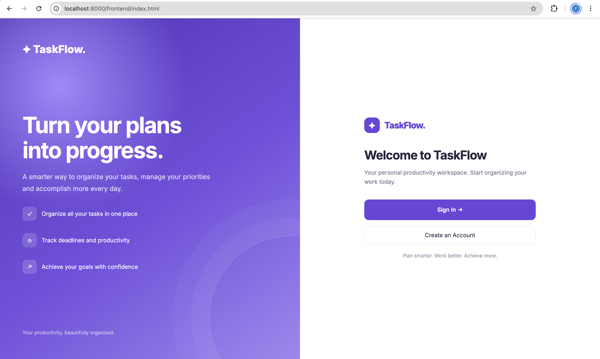

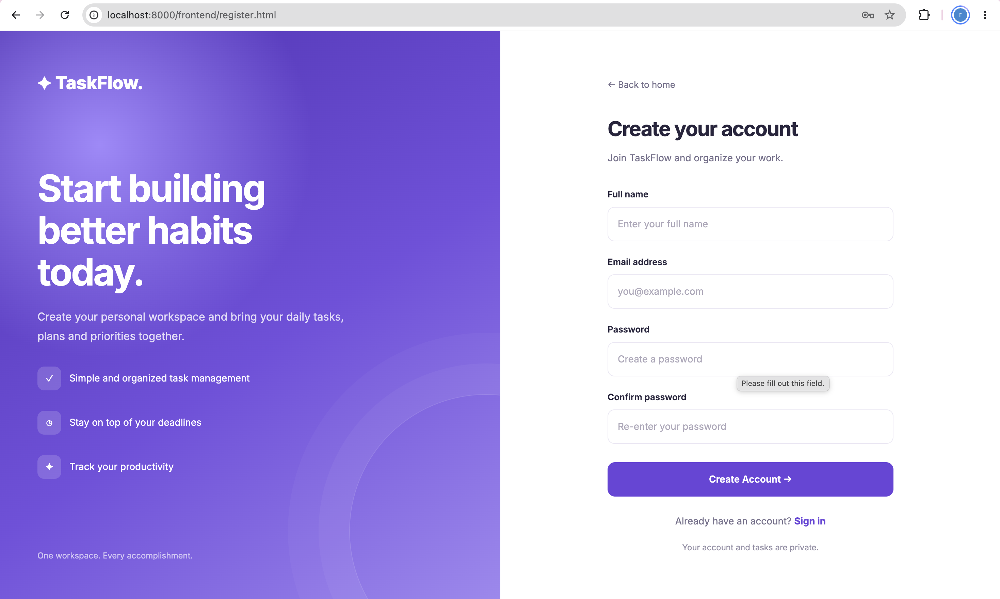

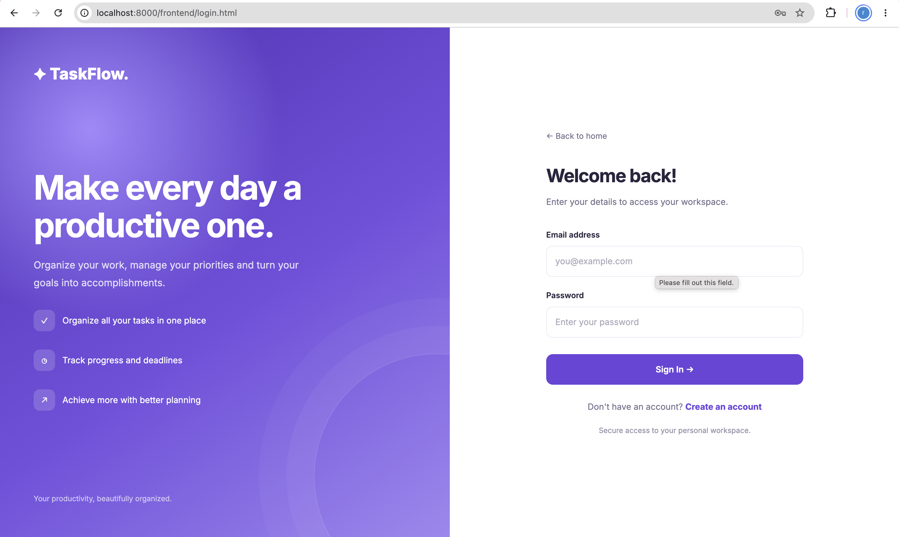

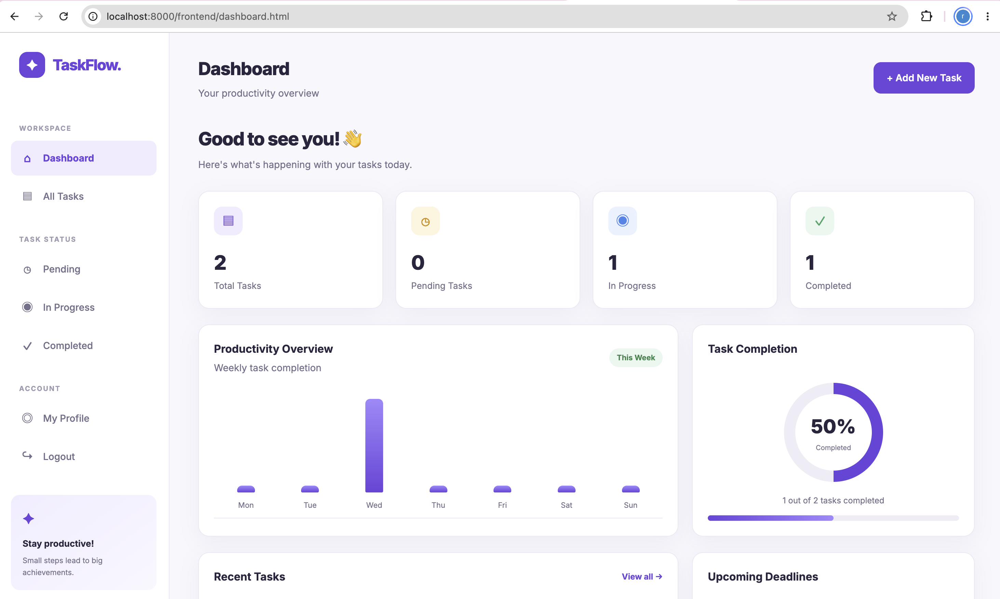

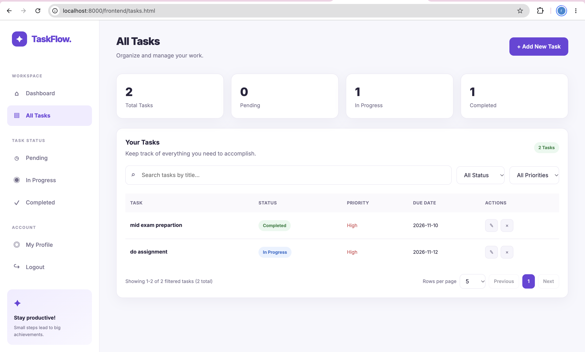

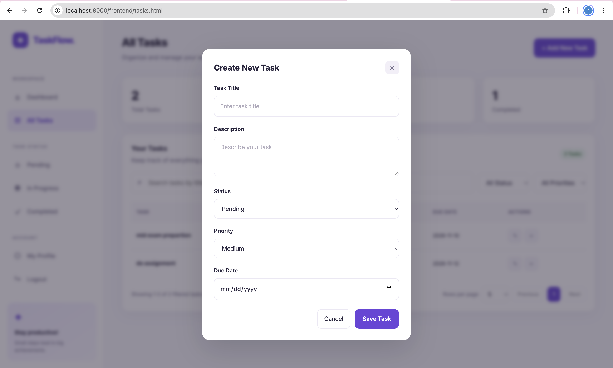

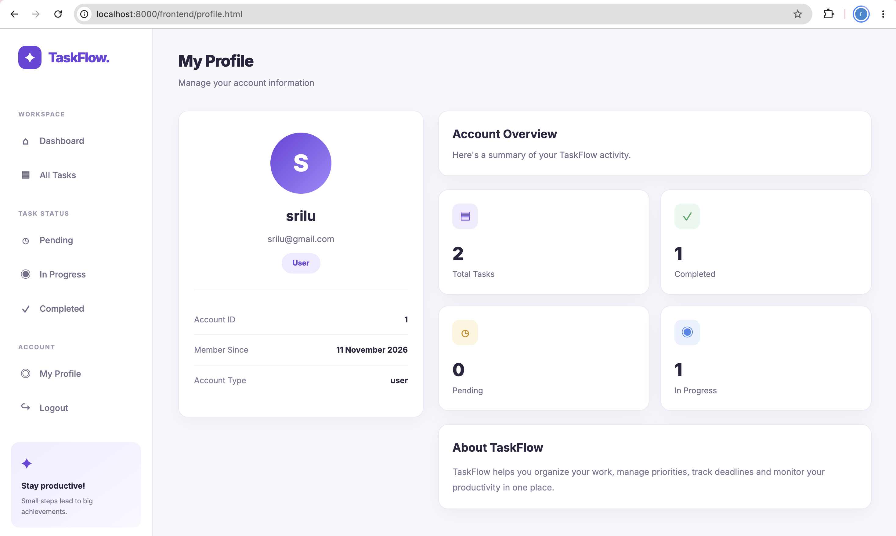

### Mobile Screenshots

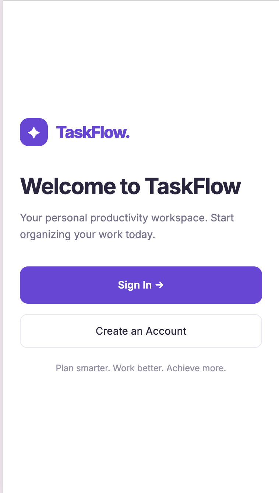

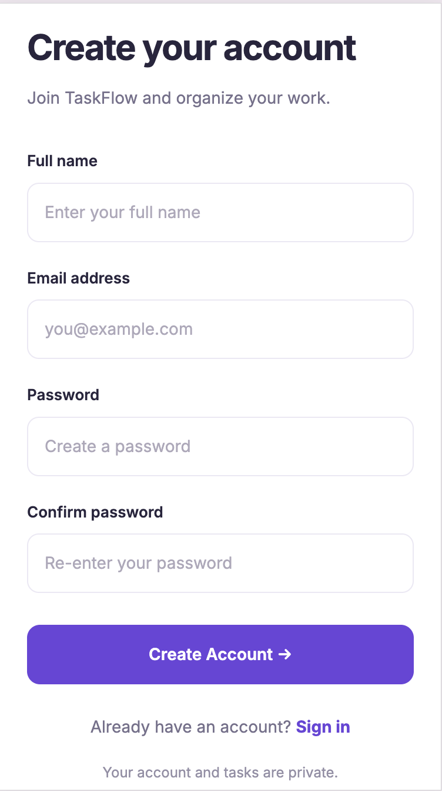

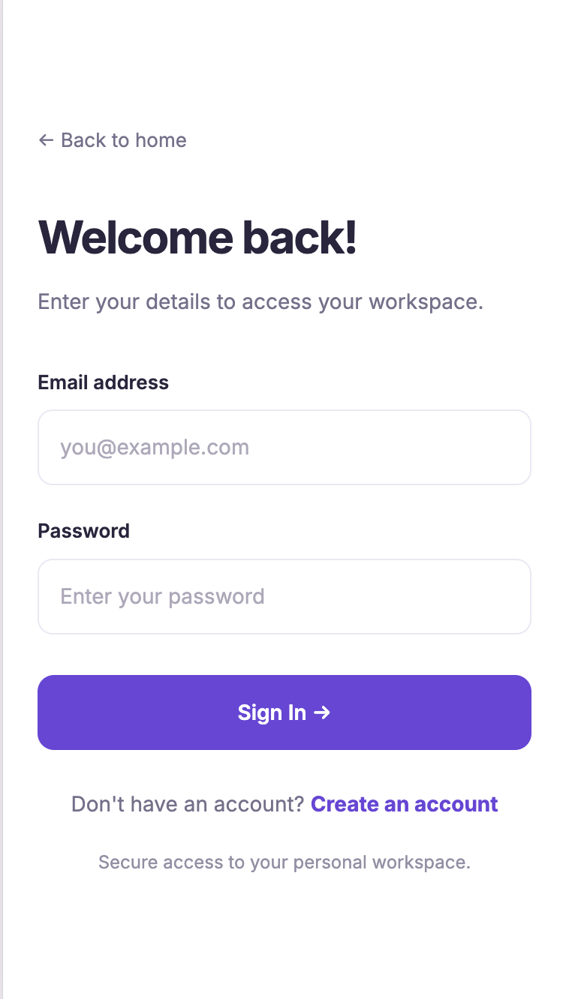

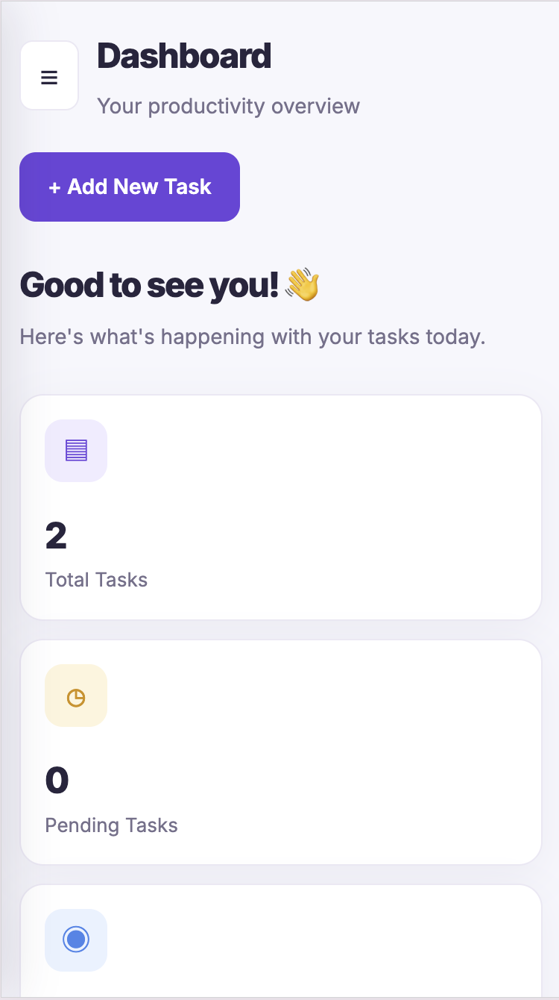

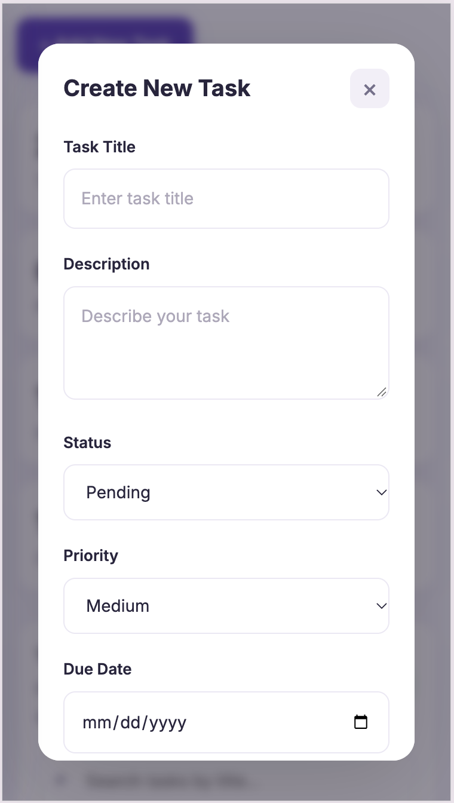

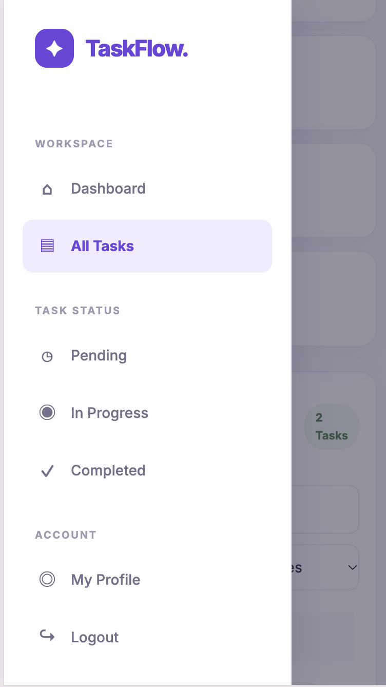

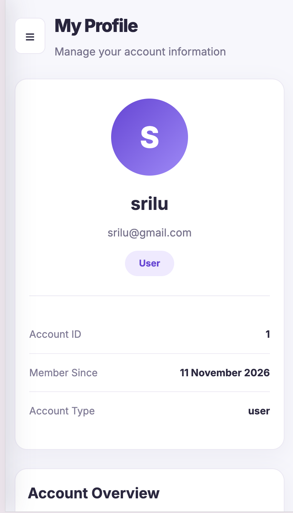

## 12. Limitations

- The admin role is defined in the database, but a dedicated admin dashboard is not implemented.
- The application is configured for local development and requires server/database configuration before deployment.
- Email verification and password reset functionality are not included.

## 13. AI Coding Assistant Disclosure

An AI coding assistant (ChatGPT) was used during development for technical guidance, debugging assistance, code suggestions, and documentation support. The project was implemented, configured, tested, and reviewed by the developer.

## 14. Developer

**Name:** Revanth Nag  
**Project:** TaskFlow – Task Management System  
**Technologies:** HTML, CSS, JavaScript, PHP, MySQL

---

**End of README**